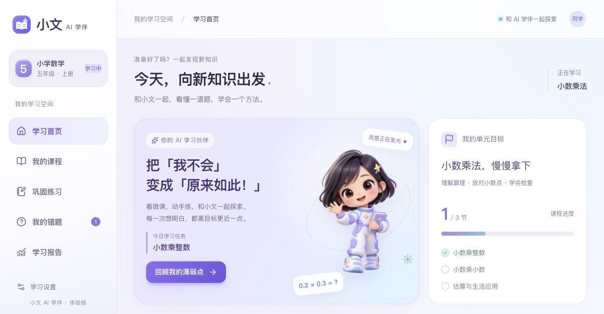

<p align="center"></p>
<h1 align="center">小文 AI 学伴 v2</h1>
<p align="center">面向小学数学的网页版 AI 学习产品：微课 → 练习 → 按需辅导 → 订正 → 新题复测 → 学习报告</p>
<p align="center">浅紫冰蓝 · 3D Q版学伴 · 轻科技风 · 适配桌面和手机</p>

**这是独立的 v2 仓库。** [第一版小文AI学伴](https://github.com/xxwxixiwen/xiaowen-ai-study-buddy)保留原状。v2基于第一版和 [DeepTutor](https://github.com/HKUDS/DeepTutor)继续开发，保留原项目的Apache-2.0许可与第三方声明。



## 这一版可以体验什么

| 模块 | 当前实现 |
|---|---|
| 学习首页 | 根据未订正错题、待复测记录和课程进度给出下一步入口 |
| 我的课程 | 3节小数乘法图文/互动微课，2节基础运算视频入口；方格可视化实验 |
| 巩固练习 | 30道固定数学题，服务端确定性判题，支持常见单位、标点和简单真等式 |
| AI学伴 | 换一种讲法、给一个提示、示范第一步；使用课程知识卡、当前题目与近期作答 |
| 错题复测 | 区分订正与新题独立通过，保存原错题和未练同类题的关联 |
| 学习报告 | 首次独立正确率、订正、复测进展和近期作答；刷新后保留 |

只有学生主动提问或点击AI帮助时才调用模型。固定提示、判题、选题、复测和统计不调用模型。AI单次输出上限为400 tokens，使用最近6条历史消息；输入上下文也会产生模型费用。

学生端当前使用固定教研知识卡，**没有把基础框架的全部RAG能力接入学习页**。视频课程问答目前依据知识卡，不读取画面、字幕或播放位置。判断类题目会说明“只核对判断结果，理由尚未验证”。本项目是供少量用户体验的单元原型，复测通过不代表长期掌握。

## 本地运行

需要 Python 3.11+、Node.js 22+ 和 npm。以下命令在仓库根目录执行：

```bash
git clone https://github.com/xxwxixiwen/xiaowen-ai-study-buddy-v2.git
cd xiaowen-ai-study-buddy-v2
python3 -m venv .venv
source .venv/bin/activate
pip install -e '.[server]'
(cd web && npm ci --legacy-peer-deps)
```

macOS可在完成安装后双击仓库中的 `启动小文AI学伴.command`。也可以分别开启两个终端：

```bash
# 终端1：后端
source .venv/bin/activate
export DEEPTUTOR_HOME="$PWD"
export XIAOWEN_MEDIA_ROOT="$PWD/media"
python -m uvicorn deeptutor.api.main:app --host 127.0.0.1 --port 8001
```

```bash
# 终端2：前端
cd web
BACKEND_PORT=8001 npm run dev -- --hostname 127.0.0.1 --port 3782
```

打开 [学习首页](http://127.0.0.1:3782/study)。在[模型设置](http://127.0.0.1:3782/settings)配置自己的对话模型及密钥。基础学练与固定提示可先体验；AI问答需要可用的模型服务。密钥、对话和学习记录保存在本地私有运行目录，不随源码发布。

## 视频素材

两段本地原始视频约136MB、359MB，未放入Git源码仓库。图文微课、方格实验、30题与学习闭环都在源码中。

如果你有对应视频，将它们放进本地 `media/` 目录，文件名保持为：

```text
media/
  加法竖式（不进位）-定稿.mp4
  减法竖式（不退位）.mp4
```

也可以用 `XIAOWEN_MEDIA_ROOT` 指向已有视频目录。没有视频时，课程页面会说明无法播放，仍可阅读本节知识卡。

## 验证范围

学生端专项后端/API测试58项、前端交互与超时测试6项通过；当前前端类型检查和生产构建通过。曾实际验证“错答→提示→订正→新题独立复测→刷新报告”，并检查桌面与390px手机宽度。

这些结论仅对应学生端专项。基础框架的全仓库检查仍有未通过或未完成部分，不能表述为全仓库测试通过。

```bash
# 测试依赖按需安装
pip install -e '.[dev]'
python -m pytest tests/services/test_k12_learning.py tests/api/test_k12_learning.py -q
cd web
node node_modules/vitest/vitest.mjs run tests/study-learning-loop.spec.tsx tests/study-request-timeout.spec.ts
npm run typecheck
npm run build
```

## 主要文件

```text
web/features/study/                  学生页面、学伴面板、视觉主题
web/app/study/[[...path]]/page.tsx    学生路由
web/public/brand/                   品牌与静态3D角色素材
deeptutor/services/k12_learning.py   判题、学习记录、错题与复测关联
deeptutor/services/k12_catalog.json  30题固定题库
deeptutor/api/routers/k12_learning.py 学习API与模型调用
```

角色素材由图像生成工具一次性制作，展示时不会调用模型；提示词和素材说明见 [ASSETS.md](web/features/study/ASSETS.md)。

## 致谢与许可

本项目基于 [DeepTutor](https://github.com/HKUDS/DeepTutor)（HKUDS，Apache-2.0）二次开发。基础框架提供通用运行时、模型服务与管理界面；本仓库增加学生学习流程、K12内容与v2视觉。

见 [LICENSE](LICENSE)、[THIRD_PARTY_NOTICES.md](THIRD_PARTY_NOTICES.md)、[UPSTREAM_README.md](UPSTREAM_README.md)。
